# Informe de desarrollo — Red de la Ciudad Comercial Cayalá

**Universidad de San Carlos de Guatemala**  
**Facultad de Ingeniería — Ingeniería en Ciencias y Sistemas**  
**Curso:** Redes de Computadoras 1  
**Práctica 2 — Segundo semestre de 2026**  
**Estudiante:** Dorbal Emilio Aldana Ramos  
**Carnet:** 202400388

---

## Introducción

La práctica consiste en diseñar y simular una red para cinco zonas de Ciudad Cayalá. Se usó Cisco Packet Tracer para representar switches principales 3560, switches de acceso 2960, computadoras y laptops. Se buscó que las zonas tuvieran formas de conexión distintas según la importancia de la comunicación y que existieran enlaces redundantes donde resultaran útiles.

El informe describe el diseño visible y las verificaciones que aparecen en las capturas proporcionadas. Las observaciones sobre pruebas o errores se basan en lo que realmente muestran las imágenes: no se asume que una prueba pendiente ya se haya ejecutado.

## Diseño e implementación

### Contexto y referencia del complejo

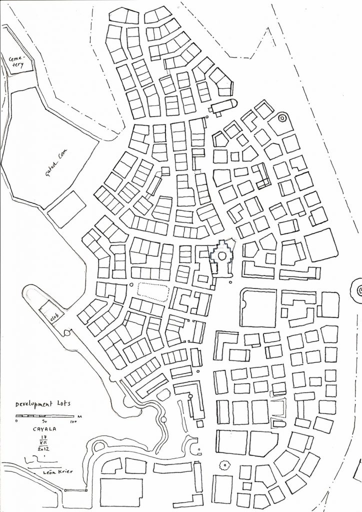

*Figura 1. Mapa aportado como referencia visual del complejo; no constituye una planta de cableado ni localiza con precisión los switches representados.*

### Topología general

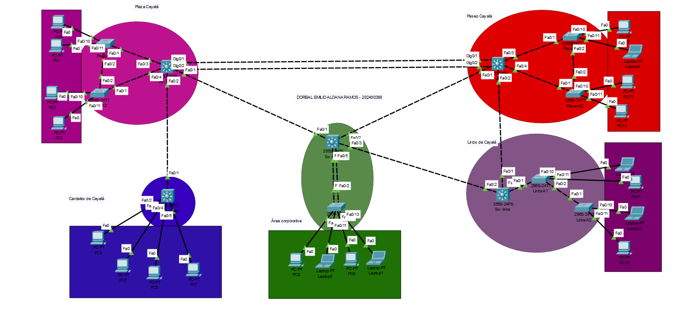

*Figura 2. Cinco zonas conectadas mediante enlaces de capa 2; el diseño combina conexiones en estrella y conexiones redundantes entre switches.*

Se distinguen **cinco switches 3560**, uno por zona; **siete 2960** para acceso en cuatro de las zonas; y **20 dispositivos finales** (15 PC y cinco laptops). Los dispositivos de cada sector se conectan al switch principal, directamente o por medio de switches de acceso. La estructura cambia según la zona, en lugar de repetirse idéntica en todas.

### Plaza Cayalá

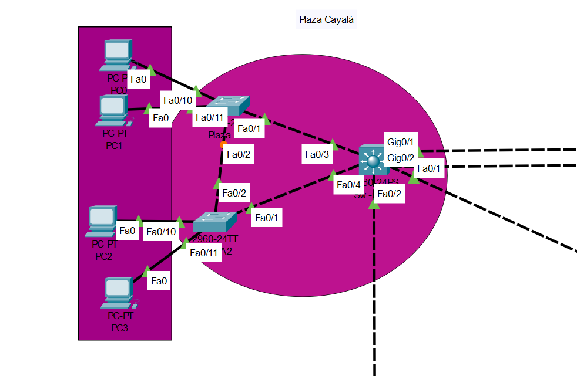

*Figura 3. Dos switches de acceso enlazados al principal y a las PC0–PC3.*

Plaza incluye enlaces internos redundantes y una doble conexión hacia Paseo. El sector representa una zona comercial para la cual es conveniente mantener conectividad y capacidad de enlace. La VLAN utilizada es **18 (`Z1_PLAZA`)**, como aparece en la consola de los switches principales.

### Lirios de Cayalá

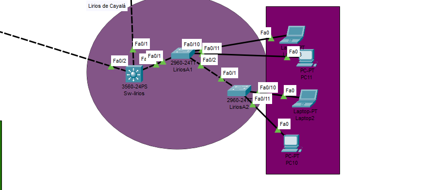

*Figura 4. Un principal, dos switches de acceso y los equipos PC10, PC11, Laptop2 y Laptop3.*

Lirios conserva dos switches de acceso con rutas locales alternativas. La VLAN correspondiente es **28 (`Z2_LIRIOS`)**. El uso de Rapid PVST+ resulta importante por las conexiones que forman caminos físicos redundantes.

### Área Corporativa

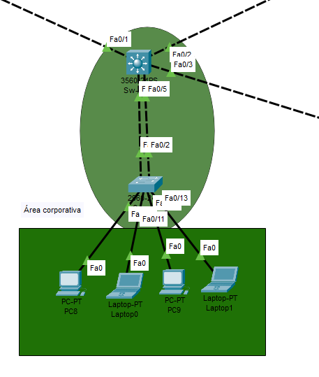

*Figura 5. Switch principal, switch de acceso, PC8, PC9, Laptop0 y Laptop1.*

Es un área con enlaces hacia otras zonas y dos conexiones locales entre el 3560 y el 2960. Se asigna **VLAN 38 (`Z3_CORPORATIVA`)**. La consola del principal permite comprobar la configuración de trunks con VLAN nativa 99.

### Paseo Cayalá

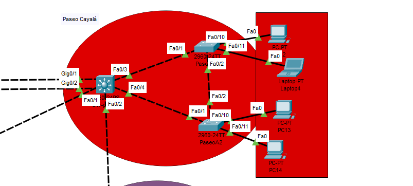

*Figura 6. Dos switches de acceso, cuatro equipos finales y enlaces hacia el resto de la red.*

Se asigna **VLAN 48 (`Z4_PASEO`)**. Por su diseño comercial y la doble conexión hacia Plaza, se utilizó como zona de referencia para comprobar EtherChannel con LACP.

### Cardales de Cayalá

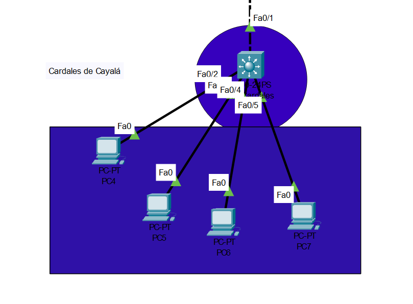

*Figura 7. Cuatro computadoras conectadas directamente al switch principal.*

Cardales corresponde a **VLAN 58 (`Z5_CARDALES`)**. En su salida `show vlan brief`, las interfaces `Fa0/2` a `Fa0/5` aparecen en la VLAN 58. La conexión interzona visible depende de un solo enlace hacia Plaza.

## Configuración de VLAN y VTP

Las VLAN requeridas se derivaron de la terminación **8** del carnet `202400388`. En las capturas aparecen las VLAN **18, 28, 38, 48, 58**, la VLAN **99** para administración/trunk nativa y la VLAN **999** para Blackhole. También se observa el dominio VTP **202400388** y el modo **Server** en los principales.

| VLAN | Nombre en la configuración | Área |
|---:|---|---|
| 18 | `Z1_PLAZA` | Plaza Cayalá |
| 28 | `Z2_LIRIOS` | Lirios de Cayalá |
| 38 | `Z3_CORPORATIVA` | Área Corporativa |
| 48 | `Z4_PASEO` | Paseo Cayalá |
| 58 | `Z5_CARDALES` | Cardales de Cayalá |
| 99 | `ADMIN_NATIVA` | Administración |
| 999 | `BLACKHOLE` | Puertos inactivos |

### Evidencias de configuración por sector

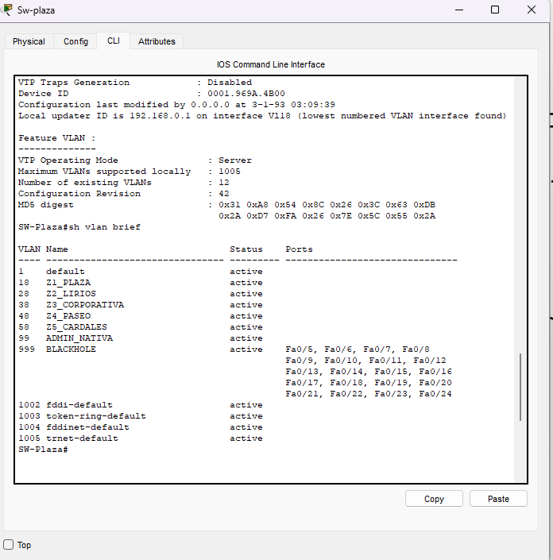

*Figura 8. VLANs presentes en `SW-Plaza` y estado VTP servidor.*

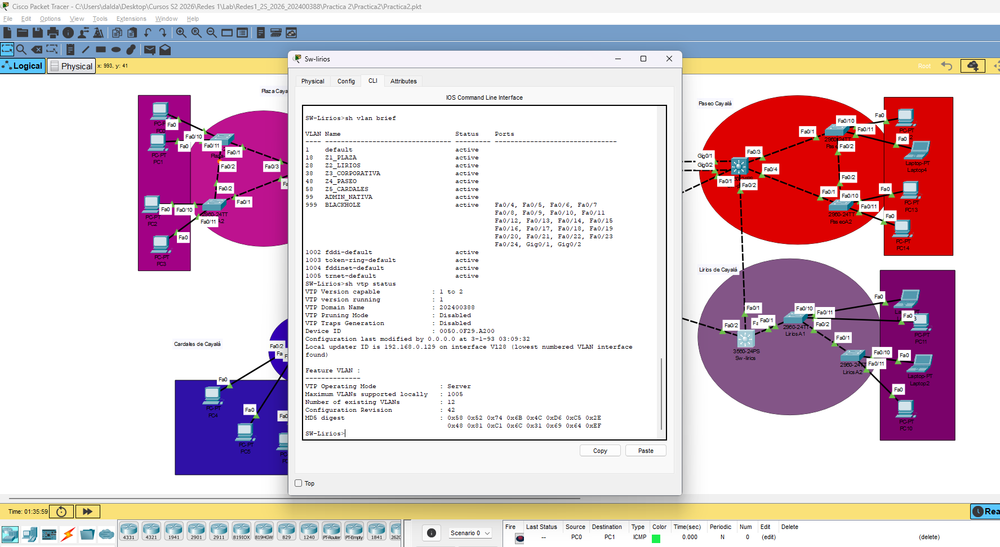

*Figura 9. `SW-Lirios` con dominio VTP `202400388`.*

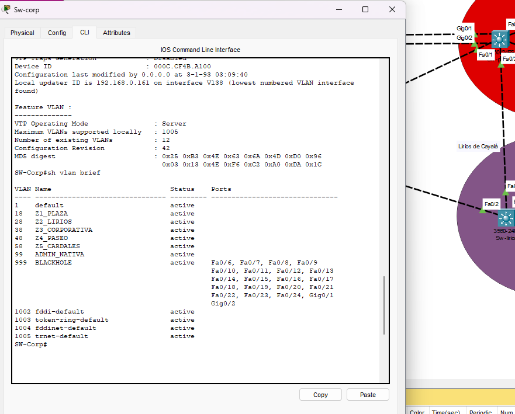

*Figura 10. `SW-Corp` con las VLANs activas y puertos inactivos en Blackhole.*

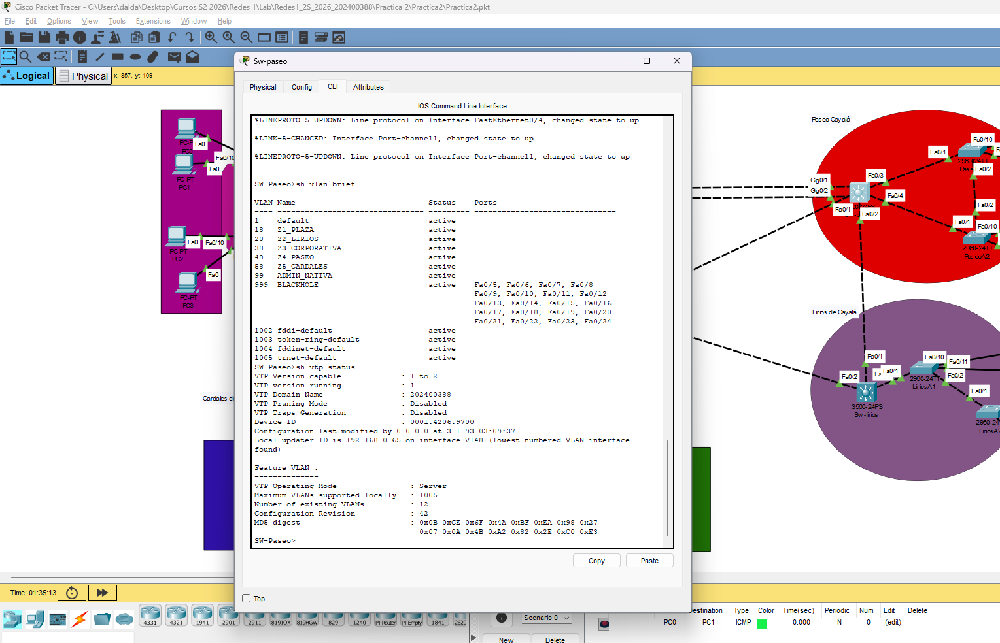

*Figura 11. `SW-Paseo` muestra las VLANs y la revisión de VTP.*

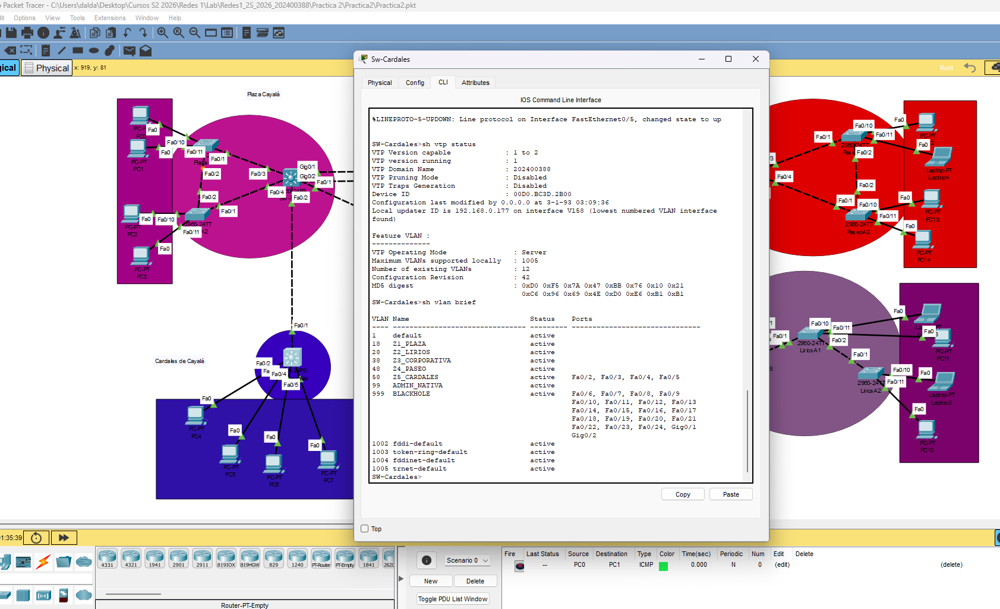

*Figura 12. `SW-Cardales` con VLAN 58 asociada a los puertos de sus cuatro PCs.*

Estas evidencias respaldan la segmentación y los switches servidores de zona. No incluyen una captura de VTP **Client** en los switches 2960; queda como verificación adicional.

## Verificación de trunks, STP y EtherChannel

### Troncales en el switch Corporativo

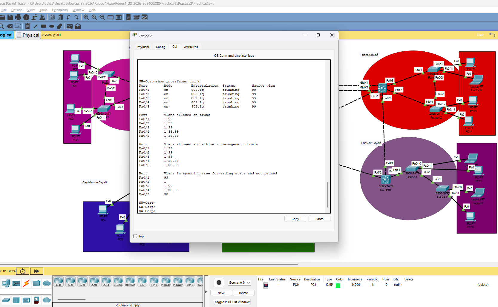

*Figura 13. `show interfaces trunk`: cinco interfaces FastEthernet con encapsulación 802.1Q, VLAN nativa 99 y listas de VLANs permitidas.*

Se comprobó que los trunks no utilizan una política de permitir todas las VLANs. Los puertos `Fa0/1`–`Fa0/3` permiten `1,99`, mientras que `Fa0/4` y `Fa0/5` permiten `1,38,99`. Es necesario comprobar que estas restricciones no excluyan VLANs que deban cruzar los enlaces interzona.

### Rapid PVST+ y puertos apagados

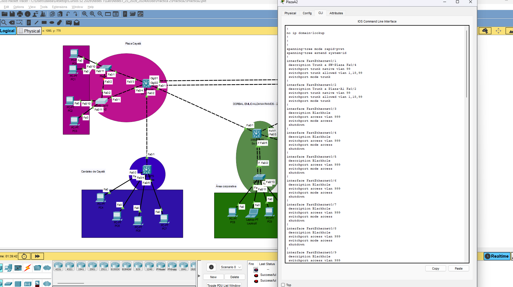

*Figura 14. `PlazaA2`: `spanning-tree mode rapid-pvst`, enlaces trunk con nativa 99 y puertos de VLAN 999 en estado `shutdown`.*

El fragmento de configuración respalda el uso de Rapid PVST+ en ese switch y el aislamiento de interfaces no utilizadas. Aún no se cuenta con capturas que permitan mostrar el root bridge de cada VLAN o los estados de las interfaces STP de todos los switches.

### LACP en Paseo

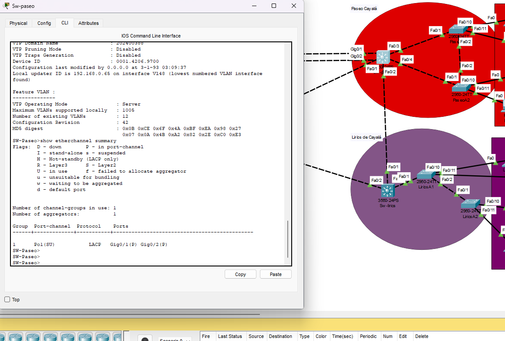

*Figura 15. `show etherchannel summary` en `SW-Paseo`: `Po1(SU)` con LACP, `Gig0/1(P)` y `Gig0/2(P)`.*

Este resultado sí permite afirmar que el EtherChannel de Paseo aparece activo y con sus dos interfaces agrupadas. Al terminar el carnet en 8, se cumple el criterio de utilizar **LACP** y no PAgP en el enlace mostrado.

## Pruebas realizadas y resultados

### Ping exitoso desde PC5

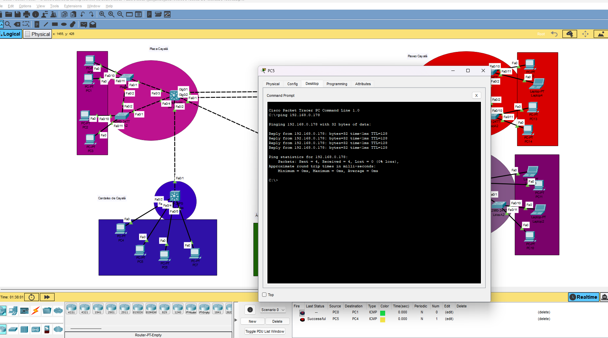

*Figura 16. `PC5` realiza ping a `192.168.0.178`: cuatro respuestas y 0 % de pérdida.*

En la consola se leen **cuatro paquetes enviados, cuatro recibidos y ninguno perdido**. Esta evidencia valida una comunicación IP concreta entre el origen y el destino consultado.

### Ping desde PC3 con pérdida inicial

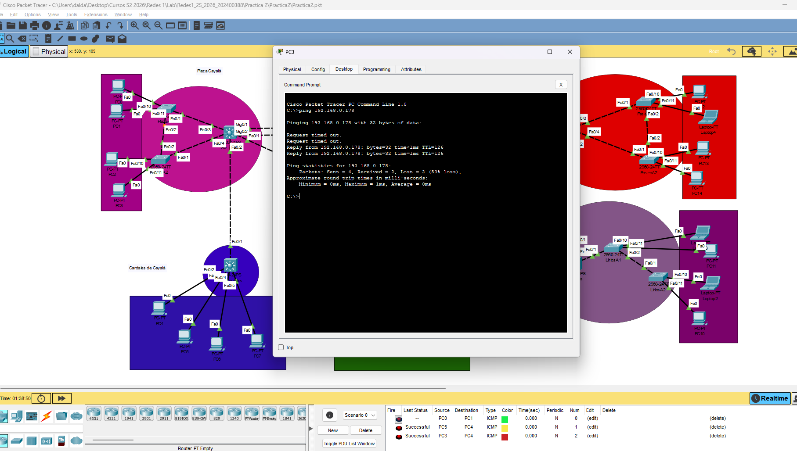

*Figura 17. `PC3` realiza ping a `192.168.0.178`: dos respuestas y dos `Request timed out` (50 % de pérdida).*

La prueba llegó a funcionar durante los intentos finales, pero **no fue completamente exitosa**. La imagen no permite determinar si los dos primeros tiempos de espera ocurrieron por ARP, convergencia o algún otro problema. La acción apropiada es repetirla y comprobar direcciones IP, VLANs y gateway si continúa el problema.

| Equipo que ejecuta ping | Destino | Enviados | Recibidos | Perdidos | Resultado visible |
|---|---|---:|---:|---:|---|
| PC5 | `192.168.0.178` | 4 | 4 | 0 | Exitoso |
| PC3 | `192.168.0.178` | 4 | 2 | 2 | Parcial |

De esta manera **no se afirma** que ya se hayan hecho los diez pings exitosos requeridos por el PDF ni que todos los hosts de todas las zonas tengan conectividad comprobada.

## Problemas, limitaciones y seguimiento

Esta sección incluye los resultados visibles y las verificaciones que aún deben hacerse, sin atribuir problemas a causas que no fueron observadas:

| Hallazgo | Interpretación | Acción recomendada |
|---|---|---|
| `PC3` muestra 50 % de pérdida hacia `.178` | La conectividad fue parcial en esa ejecución | Repetir el ping; verificar ARP, direcciones, gateways y estabilidad |
| `PC5` registra 0 % de pérdida hacia `.178` | La comunicación de ese par funcionó en la captura | Guardar la evidencia y ampliar a otros hosts |
| EtherChannel `Po1(SU)` con dos puertos `P` | LACP operativo en Paseo | Probar desconexión de un miembro si se requiere comprobar redundancia |
| Rapid PVST+ aparece en `PlazaA2` | Al menos ese equipo usa el protocolo | Consultar `show spanning-tree` en los principales |
| Trunks corporativos usan listas restringidas | Se limita propagación de VLANs | Confirmar qué VLANs deben recorrer cada trunk |
| Cinco switches principales aparecen en VTP Server | Rol principal coherente con el enunciado | Tomar `show vtp status` de un 2960 por cada zona que tenga accesos |
| No se adjunta `show ip route` | No se documenta todavía la tabla de enrutamiento | Capturar rutas e interfaces del equipo que enruta |
| El archivo mostrado tiene 20 dispositivos finales | Es una muestra frente a 157 hosts exigidos | Completar o aclarar la representación ante el criterio docente |

## Dominios de colisión y segmentación

El análisis de la topología permite estimar **38 enlaces físicos conmutados**: 20 conexiones a dispositivos finales, 11 enlaces de switches dentro de las zonas y 7 enlaces entre switches principales. Cada enlace es un segmento independiente, aunque la comunicación full dúplex moderna no sufra colisiones físicas normales. Las cinco VLANs de usuarios segmentan los dominios de difusión (*broadcast*) y la VLAN 99 sirve como dominio adicional de administración allí donde esté activa.

## Estado del cumplimiento de la práctica

A partir de las evidencias recibidas se pueden documentar la topología híbrida, las cinco VLAN de zona, las VLAN 99/999, el dominio VTP según carnet, Rapid PVST+ en un switch, trunks de Corporativa, EtherChannel LACP en Paseo y dos ejecuciones de ping. **Continúa pendiente** acreditar los root bridges y prioridades, el VTP Client en los 2960, la tabla de rutas, el direccionamiento completo, las diez pruebas intra-VLAN exigidas y el alcance de los 157 hosts.

## Cierre

La simulación representa cinco sectores diferentes mediante estructuras de conexión acordes con una topología híbrida. Las capturas confirman varios elementos que inicialmente solo podían inferirse: la existencia de las VLAN, la configuración VTP de los principales, los trunks de Corporativa, Rapid PVST+ en PlazaA2 y un EtherChannel LACP operativo en Paseo. La evidencia de ping confirma comunicación para PC5, mientras que PC3 muestra una primera ejecución con pérdida parcial que merece una segunda prueba.

Los dos documentos Markdown y todas las imágenes pueden integrarse al repositorio solicitado, dentro de `Redes1_2S2026/Practica2/`. El proyecto `.pkt` y los scripts CLI completos deben incorporarse desde la instalación real de Packet Tracer.

## Fuentes del informe

- Enunciado de la práctica de Redes de Computadoras 1 (USAC), segundo semestre de 2026.
- Seis capturas de la topología y once nuevas imágenes aportadas de plano, configuración y pruebas.
