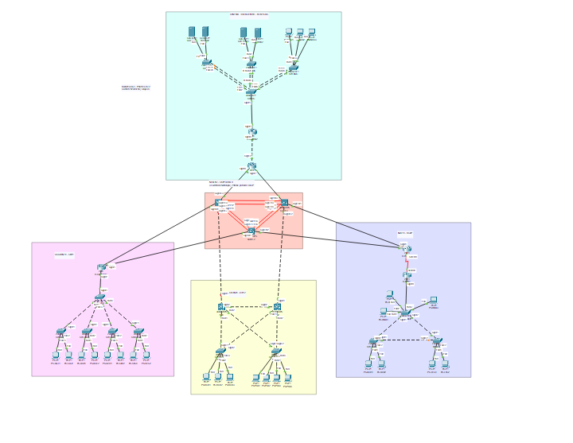
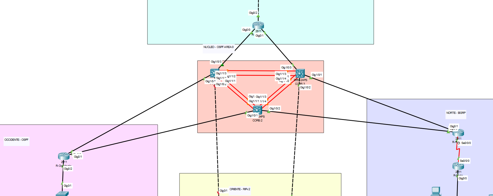
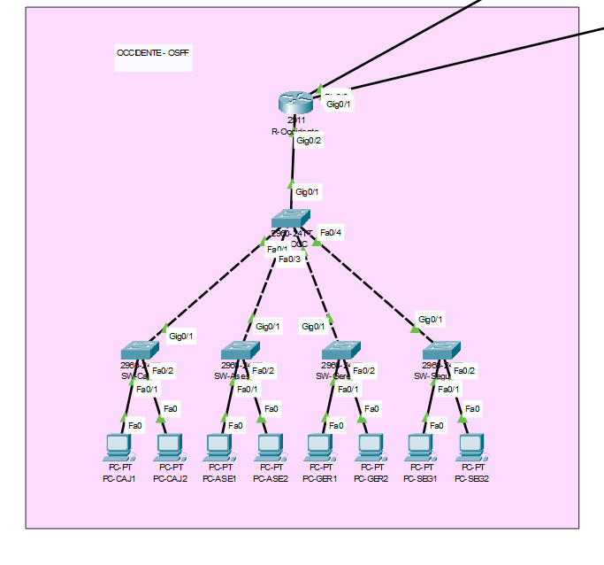
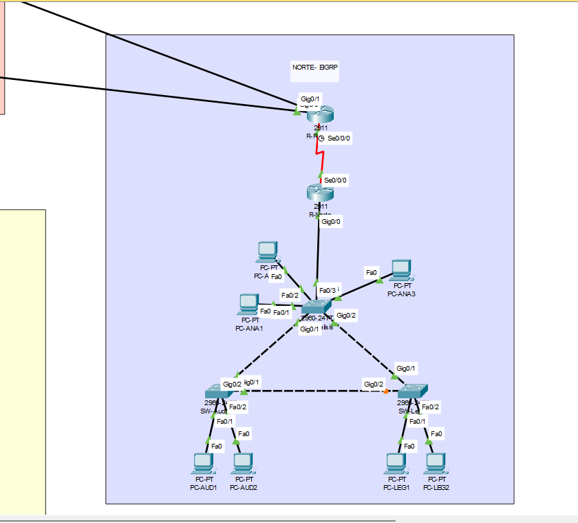
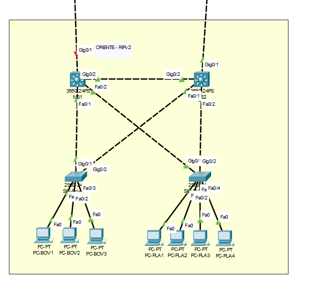
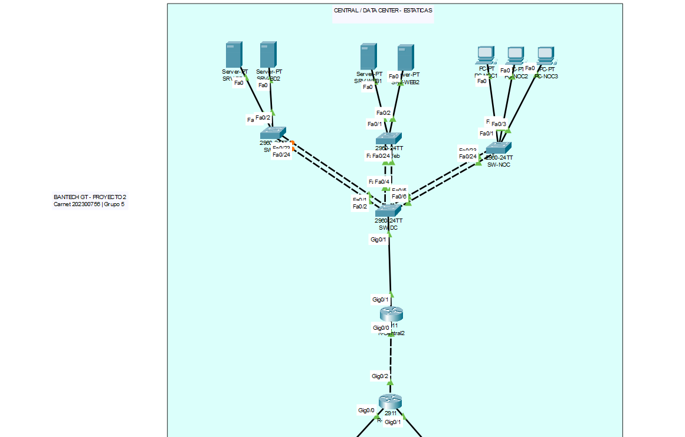
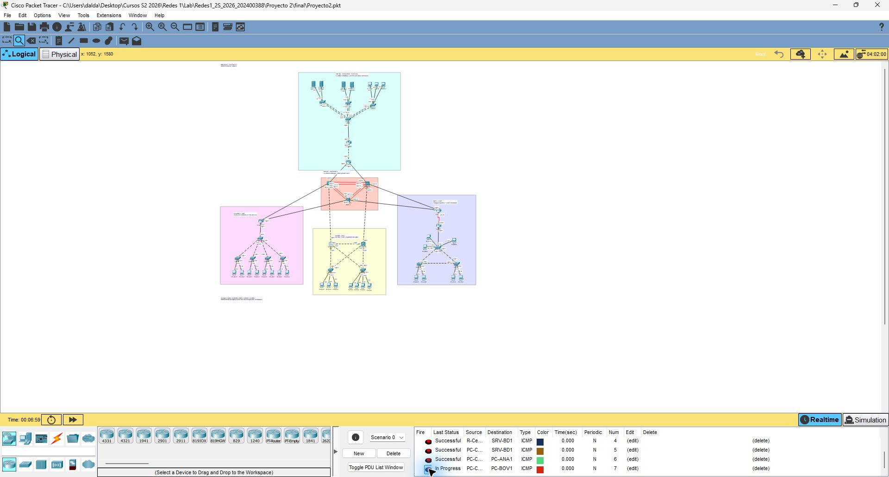
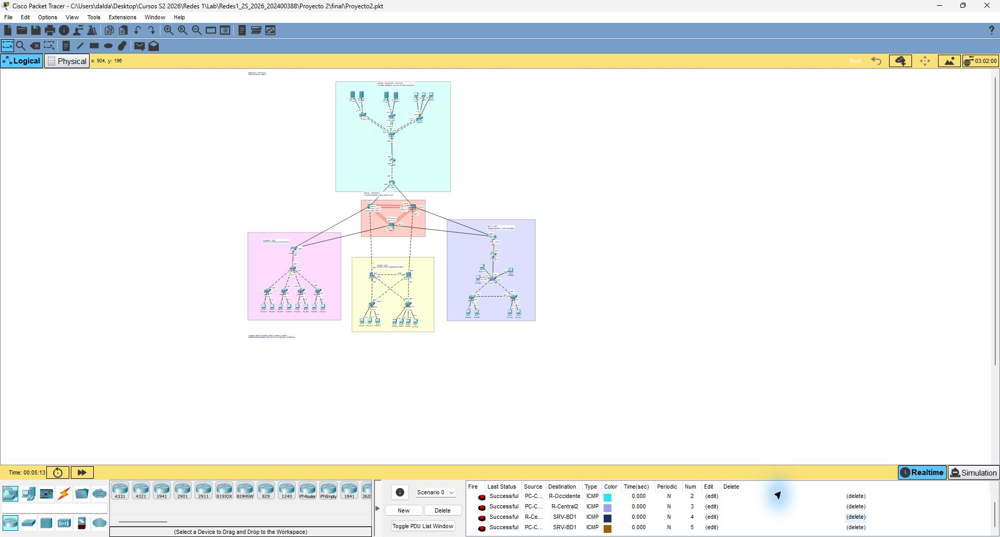
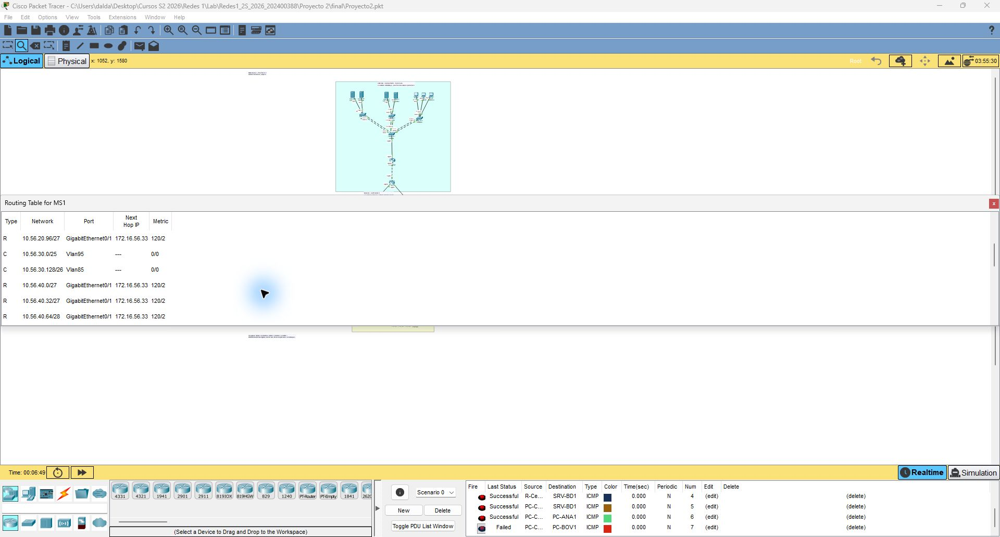
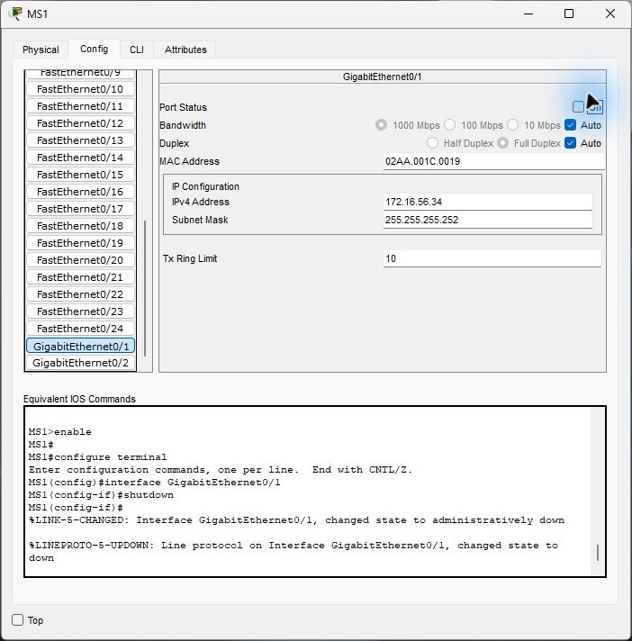

# Proyecto 2 — Infraestructura Financiera y Alta Disponibilidad BanTech GT

**Universidad de San Carlos de Guatemala — Facultad de Ingeniería**  
**Curso:** Redes de Computadoras 1 · **Período:** Segundo semestre de 2026  
**Grupo:** 5 · **Carnet del coordinador:** 202300756  
**Simulador:** Cisco Packet Tracer (el material incluido indica versión 8.2.2)  
**Archivo de simulación:** [`Proyecto2.pkt`](Proyecto2.pkt)

> **Alcance de este documento.** Este `README.md` reúne el manual técnico solicitado en el apartado 4.9 del enunciado, utilizando el material disponible en `Proyecto 2.zip` y las capturas facilitadas. El contenido de configuración procede del manual incluido en el ZIP. Las imágenes permiten documentar el diseño visual y algunas pruebas, pero no acreditan por sí solas una ejecución completa y exitosa de todas las verificaciones en Packet Tracer.

## Contenido

1. [Identificación y apertura](#1-identificación-y-apertura)
2. [Arquitectura y decisiones](#2-arquitectura-y-decisiones)
3. [VLANs y VLSM](#3-vlans-y-vlsm)
4. [Enlaces del backbone](#4-enlaces-del-backbone)
5. [Equipos finales y puertos de acceso](#5-equipos-finales-y-puertos-de-acceso)
6. [Cableado de infraestructura](#6-cableado-de-infraestructura)
7. [Configuración aplicada por dispositivo](#7-configuración-aplicada-por-dispositivo)
8. [Verificación y evidencias](#8-verificación-y-evidencias)
9. [Cambios respecto al archivo recibido](#9-cambios-respecto-al-archivo-recibido)
10. [Fuentes y entrega](#10-fuentes-y-entrega)

## Vista general de la red



**Figura 1.** Distribución nacional: Data Center y sede central (parte superior), backbone redundante (centro), Occidente (izquierda), Oriente (inferior) y Norte (derecha). Las zonas coloreadas pertenecen a las capturas del simulador y se conservan para facilitar la identificación visual.

| Segmento | Dominio de enrutamiento | Mecanismo principal | Función |
|---|---|---|---|
| Backbone | OSPF área 0 | Núcleo de tres switches multicapa y EtherChannel LACP | Transporte y convergencia entre sedes |
| Occidente | OSPF | Router-on-a-Stick y VTP | Red de cajas, asesores, gerencia y seguridad |
| Norte | EIGRP AS 56 | Rapid PVST+ con triángulo de switches | Análisis, auditoría y legal |
| Oriente | RIPv2 | HSRP con MS1 y MS2 | Bóveda y plataforma financiera |
| Central / Data Center | Rutas estáticas; redistribución hacia OSPF | EtherChannel LACP en enlaces de acceso | Bases de datos, aplicaciones web y NOC |

**Criterio de diseño.** Se separan las funciones mediante VLAN, se aplica enrutamiento inter-VLAN y se interconectan los dominios mediante el núcleo. La redundancia se implementa donde el enunciado la exige, sin asumir que elimina todos los puntos únicos de falla.

---

## 1. Identificación y apertura

- Carnet del coordinador: **202300756**; `XX = 56`.
- Grupo: **5**; `Y = 5`.
- Dominio VTP: `bantech56`; contraseña de laboratorio: `cisco`.
- Simulación incluida: [Proyecto2.pkt](Proyecto2.pkt). El manual previo indica Cisco Packet Tracer 8.2.2; esta entrega no supone verificación independiente en el simulador.
- Las VLANs `1Y+1`, `2Y+1` y `3Y+1` corresponden a **16, 26 y 36**.

Al abrir, usar **Realtime** y permitir que converjan STP, LACP y los protocolos de enrutamiento. El botón **Fast Forward Time** ayuda a completar la convergencia inicial. Un primer ping puede perder paquetes mientras se resuelve ARP; se debe repetir antes de diagnosticar una falla.

## 2. Arquitectura y decisiones

### Backbone



**Figura 2.** Núcleo triangular con CORE-1, CORE-2 y CORE-3; los enlaces rojos corresponden a los enlaces físicos agregados en el esquema. Los tres dispositivos forman el transporte principal, al que se conectan los routers de borde. Los estados exactos de los port-channels deben corroborarse con `show etherchannel summary`.


Tres switches multicapa 3650-24PS forman un triángulo con dos enlaces de fibra por lado y EtherChannel LACP de capa 3. OSPF área 0 integra el núcleo. Las sedes Occidente y Norte y el router R-Central1 tienen dos conexiones hacia distintos equipos del núcleo. Hay enlaces Ethernet locales y un enlace serial WAN con R-RedisN como DCE. Los puntos de redistribución son CORE-1 y CORE-3 (OSPF/RIPv2), R-RedisN (OSPF/EIGRP 56) y R-Central1 (estáticas hacia OSPF).

### Occidente - OSPF, Router-on-a-Stick y VTP



**Figura 3.** `R-Occidente` enlaza con el switch distribuidor `SW-OCC`; desde este se conectan `SW-Cajas`, `SW-Asesores`, `SW-Gerencia` y `SW-Seguridad`, cada uno con sus equipos de acceso. Se utilizan subinterfaces 802.1Q en el router y VTP para distribuir las VLAN.


SW-OCC es el distribuidor y servidor VTP; SW-Cajas, SW-Asesores, SW-Gerencia y SW-Seguridad son clientes VTP. La estrella extendida simplifica la administración y separa los dominios de broadcast por función. R-Occidente enruta las cuatro VLANs con subinterfaces 802.1Q y anuncia sus redes por OSPF. La separación mediante VLANs no es un filtro de seguridad: se permite comunicación inter-VLAN, conforme al enunciado. El router, el distribuidor y el enlace entre ambos siguen siendo puntos únicos de falla locales.

### Norte - EIGRP y Rapid PVST+



**Figura 4.** La sede Norte utiliza un switch de distribución y dos de acceso en triángulo físico, conectado al router regional y a un enlace serial WAN. Se observan enlaces redundantes entre switches; el estado del puerto alternativo debe comprobarse con `show spanning-tree`.


SW-Analisis, SW-Auditoria y SW-Legal forman un triángulo físico. Rapid PVST+ bloquea el camino redundante necesario para evitar bucles y habilita un camino alterno cuando falla un enlace entre switches. SW-Analisis es raíz primaria por su conexión directa a R-Norte; SW-Auditoria es raíz secundaria. EIGRP AS 56 comunica R-Norte con R-RedisN mediante el enlace serial. La redundancia del anillo protege enlaces entre switches; no sustituye un segundo router o una segunda conexión ROAS.

### Oriente - RIPv2 y HSRP



**Figura 5.** `MS1` y `MS2` se interconectan y dan acceso simultáneo a `SW-Boveda` y `SW-Plataforma`. En este diseño HSRP mantiene una puerta de enlace virtual en ambas VLAN, mientras RIPv2 intercambia rutas con los extremos del núcleo.


SW-Boveda y SW-Plataforma tienen enlaces hacia MS1 y MS2. Ambos switches multicapa comparten las VLANs por una troncal y usan HSRP para conservar los gateways virtuales. MS1 tiene prioridad 105 y MS2 prioridad 100; ambos usan `preempt` y seguimiento de GigabitEthernet0/1. La caída del uplink reduce en 10 la prioridad: MS1 pasa a 95 y MS2 puede asumir el rol activo. La raíz STP principal se alinea con MS1. RIPv2 representa el dominio legado y los CORE redistribuyen sus rutas. La convergencia tiene un intervalo transitorio y no equivale a garantizar cero pérdida de paquetes.

### Central / Data Center - rutas estáticas y LACP



**Figura 6.** Los servidores de base de datos y banca virtual y los equipos del NOC llegan a `SW-DC`, que comunica con `R-Central2`; a continuación `R-Central1` intercambia la información de rutas con el backbone. Los enlaces paralelos de cada switch de acceso son EtherChannels LACP.


R-Central2 conecta las VLANs de servidores por ROAS y usa una ruta estática por defecto hacia R-Central1. Este último tiene rutas específicas de retorno y las redistribuye en OSPF. SW-DC distribuye hacia SW-BD, SW-Web y SW-NOC mediante tres EtherChannels LACP de dos cables cada uno. Cada canal ofrece capacidad agregada nominal de 200 Mb/s y tolera la pérdida de uno de sus miembros; un flujo individual no necesariamente usa los 200 Mb/s. El uso de rutas estáticas limita la participación en protocolos, pero no reemplaza ACLs o firewalls.

## 3. VLANs y VLSM

Se reservan direcciones adicionales a los hosts solicitados para el gateway. En Oriente se reservan tres: MS1, MS2 y la IP virtual HSRP. Por ello Asesores necesita /26, Legal y Core_BD /27 y Plataforma /25. Se reubican las redes contiguas que antes se superpondrían al ampliar esas máscaras.

| Sede | Nombre VLAN | ID | Hosts pedidos | Subred | Máscara | Gateway | Hosts finales disponibles | Broadcast |
|---|---|---:|---:|---|---|---|---:|---|
| Occidente | Cajas | 15 | 45 | 10.56.10.0/26 | 255.255.255.192 | 10.56.10.1 | 61 | 10.56.10.63 |
| Occidente | Asesores | 25 | 30 | 10.56.10.64/26 | 255.255.255.192 | 10.56.10.65 | 61 | 10.56.10.127 |
| Occidente | Seguridad | 45 | 12 | 10.56.10.128/28 | 255.255.255.240 | 10.56.10.129 | 13 | 10.56.10.143 |
| Occidente | Gerencia | 35 | 10 | 10.56.10.144/28 | 255.255.255.240 | 10.56.10.145 | 13 | 10.56.10.159 |
| Norte | Analisis | 55 | 50 | 10.56.20.0/26 | 255.255.255.192 | 10.56.20.1 | 61 | 10.56.20.63 |
| Norte | Auditoria | 65 | 25 | 10.56.20.64/27 | 255.255.255.224 | 10.56.20.65 | 29 | 10.56.20.95 |
| Norte | Legal | 75 | 14 | 10.56.20.96/27 | 255.255.255.224 | 10.56.20.97 | 29 | 10.56.20.127 |
| Oriente | Plataforma | 95 | 60 | 10.56.30.0/25 | 255.255.255.128 | 10.56.30.1 | 123 | 10.56.30.127 |
| Oriente | Boveda | 85 | 40 | 10.56.30.128/26 | 255.255.255.192 | 10.56.30.129 | 59 | 10.56.30.191 |
| Central | Web_Apps | 26 | 28 | 10.56.40.0/27 | 255.255.255.224 | 10.56.40.1 | 29 | 10.56.40.31 |
| Central | Core_BD | 16 | 14 | 10.56.40.32/27 | 255.255.255.224 | 10.56.40.33 | 29 | 10.56.40.63 |
| Central | NOC | 36 | 10 | 10.56.40.64/28 | 255.255.255.240 | 10.56.40.65 | 13 | 10.56.40.79 |

Oriente: Plataforma tiene MS1 `10.56.30.2`, MS2 `10.56.30.3`, VIP `10.56.30.1`; Bóveda tiene MS1 `10.56.30.130`, MS2 `10.56.30.131`, VIP `10.56.30.129`. Las PCs utilizan exclusivamente las VIP como gateways.

## 4. Enlaces del backbone

Todos los enlaces punto a punto usan máscara `255.255.255.252` (/30).

| Segmento | Extremo A | IP A | Extremo B | IP B | Protocolo |
|---|---|---|---|---|---|
| 172.16.56.0/30 | CORE-1 Po12 | .1 | CORE-2 Po12 | .2 | OSPF |
| 172.16.56.4/30 | CORE-1 Po13 | .5 | CORE-3 Po13 | .6 | OSPF |
| 172.16.56.8/30 | CORE-2 Po23 | .9 | CORE-3 Po23 | .10 | OSPF |
| 172.16.56.12/30 | CORE-1 Gi1/0/1 | .13 | R-Occidente Gi0/0 | .14 | OSPF |
| 172.16.56.16/30 | CORE-2 Gi1/0/1 | .17 | R-Occidente Gi0/1 | .18 | OSPF |
| 172.16.56.20/30 | CORE-2 Gi1/0/2 | .21 | R-RedisN Gi0/0 | .22 | OSPF |
| 172.16.56.24/30 | CORE-3 Gi1/0/1 | .25 | R-RedisN Gi0/1 | .26 | OSPF |
| 172.16.56.28/30 | R-RedisN S0/0/0 DCE | .29 | R-Norte S0/0/0 | .30 | EIGRP 56 |
| 172.16.56.32/30 | CORE-1 Gi1/0/2 | .33 | MS1 Gi0/1 | .34 | RIPv2 |
| 172.16.56.36/30 | CORE-3 Gi1/0/2 | .37 | MS2 Gi0/1 | .38 | RIPv2 |
| 172.16.56.40/30 | CORE-1 Gi1/0/3 | .41 | R-Central1 Gi0/0 | .42 | OSPF |
| 172.16.56.44/30 | CORE-3 Gi1/0/3 | .45 | R-Central1 Gi0/1 | .46 | OSPF |
| 172.16.56.48/30 | R-Central1 Gi0/2 | .49 | R-Central2 Gi0/0 | .50 | Estático |

## 5. Equipos finales y puertos de acceso

Se conservan en la simulación revisada **29 dispositivos finales representados: Occidente 8, Norte 7, Oriente 7 y Central 7**. La capacidad de cada subred se dimensiona según los **hosts solicitados por el enunciado**, no según los pocos equipos modelados. **Atención al criterio de evaluación:** el PDF exige un mínimo de **7 dispositivos finales por área** (apartado 4.6). Interpretando «área» como cada área funcional/VLAN —la lectura más estricta—, las capturas actuales muestran menos de siete por VLAN, por lo que este requisito **necesita revisión/corrección en Packet Tracer** antes de declarar cumplimiento. Con 12 áreas funcionales se necesitarían 84 equipos finales representados (55 adicionales respecto de los 29 identificados).

| Switch | VLAN | Equipos | Direcciones asignadas | Puertos |
|---|---:|---|---|---|
| SW-Cajas | 15 | PC-CAJ1 a PC-CAJ2 | 10.56.10.10 a 10.56.10.11 | Fa0/1 a Fa0/2 |
| SW-Asesores | 25 | PC-ASE1 a PC-ASE2 | 10.56.10.70 a 10.56.10.71 | Fa0/1 a Fa0/2 |
| SW-Seguridad | 45 | PC-SEG1 a PC-SEG2 | 10.56.10.130 a 10.56.10.131 | Fa0/1 a Fa0/2 |
| SW-Gerencia | 35 | PC-GER1 a PC-GER2 | 10.56.10.146 a 10.56.10.147 | Fa0/1 a Fa0/2 |
| SW-Analisis | 55 | PC-ANA1 a PC-ANA3 | 10.56.20.10 a 10.56.20.12 | Fa0/1 a Fa0/3 |
| SW-Auditoria | 65 | PC-AUD1 a PC-AUD2 | 10.56.20.70 a 10.56.20.71 | Fa0/1 a Fa0/2 |
| SW-Legal | 75 | PC-LEG1 a PC-LEG2 | 10.56.20.100 a 10.56.20.101 | Fa0/1 a Fa0/2 |
| SW-Plataforma | 95 | PC-PLA1 a PC-PLA4 | 10.56.30.10 a 10.56.30.13 | Fa0/1 a Fa0/4 |
| SW-Boveda | 85 | PC-BOV1 a PC-BOV3 | 10.56.30.138 a 10.56.30.140 | Fa0/1 a Fa0/3 |
| SW-Web | 26 | SRV-WEB1 a SRV-WEB2 | 10.56.40.10 a 10.56.40.11 | Fa0/1 a Fa0/2 |
| SW-BD | 16 | SRV-BD1 a SRV-BD2 | 10.56.40.35 a 10.56.40.36 | Fa0/1 a Fa0/2 |
| SW-NOC | 36 | PC-NOC1 a PC-NOC3 | 10.56.40.66 a 10.56.40.68 | Fa0/1 a Fa0/3 |

Todos estos puertos están en modo access con PortFast. PortFast se utiliza solo hacia equipos finales.

## 6. Cableado de infraestructura

Las conexiones switch-switch de las sedes son troncales 802.1Q. En los EtherChannels de acceso, la troncal es el Port-channel. Los enlaces del backbone son de capa 3.

| Dispositivo A | Puerto A | Dispositivo B | Puerto B | Medio |
|---|---|---|---|---|
| CORE-1 | GigabitEthernet1/1/2 | CORE-2 | GigabitEthernet1/1/2 | Fibra |
| CORE-2 | GigabitEthernet1/1/3 | CORE-3 | GigabitEthernet1/1/1 | Fibra |
| CORE-2 | GigabitEthernet1/1/4 | CORE-3 | GigabitEthernet1/1/2 | Fibra |
| CORE-3 | GigabitEthernet1/1/3 | CORE-1 | GigabitEthernet1/1/3 | Fibra |
| CORE-3 | GigabitEthernet1/1/4 | CORE-1 | GigabitEthernet1/1/4 | Fibra |
| CORE-1 | GigabitEthernet1/0/1 | R-Occidente | GigabitEthernet0/0 | Cobre |
| CORE-2 | GigabitEthernet1/0/1 | R-Occidente | GigabitEthernet0/1 | Cobre |
| R-Occidente | GigabitEthernet0/2 | SW-OCC | GigabitEthernet0/1 | Cobre |
| SW-OCC | FastEthernet0/1 | SW-Cajas | GigabitEthernet0/1 | Cobre |
| SW-OCC | FastEthernet0/2 | SW-Asesores | GigabitEthernet0/1 | Cobre |
| SW-OCC | FastEthernet0/4 | SW-Seguridad | GigabitEthernet0/1 | Cobre |
| CORE-2 | GigabitEthernet1/0/2 | R-RedisN | GigabitEthernet0/0 | Cobre |
| CORE-3 | GigabitEthernet1/0/1 | R-RedisN | GigabitEthernet0/1 | Cobre |
| R-RedisN | Serial0/0/0 | R-Norte | Serial0/0/0 | Serial |
| R-Norte | GigabitEthernet0/0 | SW-Analisis | FastEthernet0/24 | Cobre |
| SW-Analisis | GigabitEthernet0/1 | SW-Auditoria | GigabitEthernet0/1 | Cobre |
| SW-Analisis | GigabitEthernet0/2 | SW-Legal | GigabitEthernet0/1 | Cobre |
| SW-Auditoria | GigabitEthernet0/2 | SW-Legal | GigabitEthernet0/2 | Cobre |
| CORE-1 | GigabitEthernet1/0/2 | MS1 | GigabitEthernet0/1 | Cobre |
| CORE-3 | GigabitEthernet1/0/2 | MS2 | GigabitEthernet0/1 | Cobre |
| MS1 | GigabitEthernet0/2 | MS2 | GigabitEthernet0/2 | Cobre |
| MS1 | FastEthernet0/1 | SW-Boveda | GigabitEthernet0/1 | Cobre |
| MS2 | FastEthernet0/1 | SW-Boveda | GigabitEthernet0/2 | Cobre |
| MS1 | FastEthernet0/2 | SW-Plataforma | GigabitEthernet0/1 | Cobre |
| MS2 | FastEthernet0/2 | SW-Plataforma | GigabitEthernet0/2 | Cobre |
| CORE-1 | GigabitEthernet1/0/3 | R-Central1 | GigabitEthernet0/0 | Cobre |
| CORE-3 | GigabitEthernet1/0/3 | R-Central1 | GigabitEthernet0/1 | Cobre |
| R-Central1 | GigabitEthernet0/2 | R-Central2 | GigabitEthernet0/0 | Cobre |
| R-Central2 | GigabitEthernet0/1 | SW-DC | GigabitEthernet0/1 | Cobre |
| SW-DC | FastEthernet0/1 | SW-BD | FastEthernet0/23 | Cobre |
| SW-DC | FastEthernet0/2 | SW-BD | FastEthernet0/24 | Cobre |
| SW-DC | FastEthernet0/3 | SW-Web | FastEthernet0/23 | Cobre |
| SW-DC | FastEthernet0/5 | SW-NOC | FastEthernet0/23 | Cobre |
| SW-DC | FastEthernet0/6 | SW-NOC | FastEthernet0/24 | Cobre |
| CORE-1 | GigabitEthernet1/1/1 | CORE-2 | GigabitEthernet1/1/1 | Fibra |
| SW-Gerencia | GigabitEthernet0/1 | SW-OCC | FastEthernet0/3 | Cobre |
| SW-DC | FastEthernet0/4 | SW-Web | FastEthernet0/24 | Cobre |

Las troncales conservan la lista de VLANs permitidas predeterminada de IOS, de acuerdo con los extractos aportados. Esto no equivale a restringir explícitamente la lista mediante `switchport trunk allowed vlan`. Una mejora posterior de segmentación sería permitir únicamente las VLAN necesarias, tras probar que no afecta la conectividad ni VTP.

**Medios de transporte.** En el núcleo se muestran enlaces de fibra entre switches multicapa; los routers se conectan por Ethernet y la comunicación `R-RedisN`–`R-Norte` utiliza un enlace serial, conforme al apartado 4.1 del enunciado.

## 7. Configuración aplicada por dispositivo

Extractos funcionales de la configuración del archivo. Para reproducirlos se entra en `enable` y `configure terminal`, y se termina con `end` y `write memory`. Las VLANs y VTP se muestran explícitamente porque IOS puede almacenarlos en la base VLAN y no en `show running-config`.

### CORE-1

```ios
hostname CORE-1
no ip cef
ip routing
spanning-tree mode pvst
interface Port-channel12
 no switchport
 ip address 172.16.56.1 255.255.255.252
interface Port-channel13
 no switchport
 ip address 172.16.56.5 255.255.255.252
interface GigabitEthernet1/0/1
 no switchport
 ip address 172.16.56.13 255.255.255.252
 duplex auto
 speed auto
interface GigabitEthernet1/0/2
 no switchport
 ip address 172.16.56.33 255.255.255.252
 duplex auto
 speed auto
interface GigabitEthernet1/0/3
 no switchport
 ip address 172.16.56.41 255.255.255.252
 duplex auto
 speed auto
interface GigabitEthernet1/1/1
 no switchport
 no ip address
 channel-group 12 mode active
interface GigabitEthernet1/1/2
 no switchport
 no ip address
 channel-group 12 mode active
interface GigabitEthernet1/1/3
 no switchport
 no ip address
 channel-group 13 mode active
interface GigabitEthernet1/1/4
 no switchport
 no ip address
 channel-group 13 mode active
router ospf 1
 router-id 1.1.1.1
 log-adjacency-changes
 redistribute rip subnets 
 network 172.16.56.0 0.0.0.3 area 0
 network 172.16.56.4 0.0.0.3 area 0
 network 172.16.56.12 0.0.0.3 area 0
 network 172.16.56.40 0.0.0.3 area 0
router rip
 version 2
 redistribute ospf 1 metric 2 
 passive-interface default
 no passive-interface GigabitEthernet1/0/2
 network 172.16.0.0
 no auto-summary
```

### CORE-2

```ios
hostname CORE-2
no ip cef
ip routing
spanning-tree mode pvst
interface Port-channel12
 no switchport
 ip address 172.16.56.2 255.255.255.252
interface Port-channel23
 no switchport
 ip address 172.16.56.9 255.255.255.252
interface GigabitEthernet1/0/1
 no switchport
 ip address 172.16.56.17 255.255.255.252
 duplex auto
 speed auto
interface GigabitEthernet1/0/2
 no switchport
 ip address 172.16.56.21 255.255.255.252
 duplex auto
 speed auto
interface GigabitEthernet1/1/1
 no switchport
 no ip address
 channel-group 12 mode active
interface GigabitEthernet1/1/2
 no switchport
 no ip address
 channel-group 12 mode active
interface GigabitEthernet1/1/3
 no switchport
 no ip address
 channel-group 23 mode active
interface GigabitEthernet1/1/4
 no switchport
 no ip address
 channel-group 23 mode active
router ospf 1
 router-id 2.2.2.2
 log-adjacency-changes
 network 172.16.56.0 0.0.0.3 area 0
 network 172.16.56.8 0.0.0.3 area 0
 network 172.16.56.16 0.0.0.3 area 0
 network 172.16.56.20 0.0.0.3 area 0
```

### CORE-3

```ios
hostname CORE-3
no ip cef
ip routing
spanning-tree mode pvst
interface Port-channel13
 no switchport
 ip address 172.16.56.6 255.255.255.252
interface Port-channel23
 no switchport
 ip address 172.16.56.10 255.255.255.252
interface GigabitEthernet1/0/1
 no switchport
 ip address 172.16.56.25 255.255.255.252
 duplex auto
 speed auto
interface GigabitEthernet1/0/2
 no switchport
 ip address 172.16.56.37 255.255.255.252
 duplex auto
 speed auto
interface GigabitEthernet1/0/3
 no switchport
 ip address 172.16.56.45 255.255.255.252
 duplex auto
 speed auto
interface GigabitEthernet1/1/1
 no switchport
 no ip address
 channel-group 23 mode active
interface GigabitEthernet1/1/2
 no switchport
 no ip address
 channel-group 23 mode active
interface GigabitEthernet1/1/3
 no switchport
 no ip address
 channel-group 13 mode active
interface GigabitEthernet1/1/4
 no switchport
 no ip address
 channel-group 13 mode active
router ospf 1
 router-id 3.3.3.3
 log-adjacency-changes
 redistribute rip subnets 
 network 172.16.56.4 0.0.0.3 area 0
 network 172.16.56.8 0.0.0.3 area 0
 network 172.16.56.24 0.0.0.3 area 0
 network 172.16.56.44 0.0.0.3 area 0
router rip
 version 2
 redistribute ospf 1 metric 2 
 passive-interface default
 no passive-interface GigabitEthernet1/0/2
 network 172.16.0.0
 no auto-summary
```

### R-Occidente

```ios
hostname R-Occidente
spanning-tree mode pvst
interface GigabitEthernet0/0
 description Hacia_CORE-1_Gig1/0/1
 ip address 172.16.56.14 255.255.255.252
 duplex auto
 speed auto
interface GigabitEthernet0/1
 description Hacia_CORE-2_Gig1/0/1
 ip address 172.16.56.18 255.255.255.252
 duplex auto
 speed auto
interface GigabitEthernet0/2
 description ROAS_Hacia_SW-OCC_Gig0/1
 no ip address
 duplex auto
 speed auto
interface GigabitEthernet0/2.15
 encapsulation dot1Q 15
 ip address 10.56.10.1 255.255.255.192
interface GigabitEthernet0/2.25
 encapsulation dot1Q 25
 ip address 10.56.10.65 255.255.255.192
interface GigabitEthernet0/2.35
 encapsulation dot1Q 35
 ip address 10.56.10.145 255.255.255.240
interface GigabitEthernet0/2.45
 encapsulation dot1Q 45
 ip address 10.56.10.129 255.255.255.240
router ospf 1
 router-id 10.10.10.10
 log-adjacency-changes
 passive-interface GigabitEthernet0/2.15
 passive-interface GigabitEthernet0/2.25
 passive-interface GigabitEthernet0/2.35
 passive-interface GigabitEthernet0/2.45
 network 172.16.56.12 0.0.0.3 area 0
 network 172.16.56.16 0.0.0.3 area 0
 network 10.56.10.0 0.0.0.255 area 0
```

### SW-OCC

```ios
hostname SW-OCC
spanning-tree mode pvst
spanning-tree extend system-id
interface FastEthernet0/1
 description Troncales_Hacia_Switches_Acceso
 switchport mode trunk
interface FastEthernet0/2
 description Troncales_Hacia_Switches_Acceso
 switchport mode trunk
interface FastEthernet0/3
 description Troncales_Hacia_Switches_Acceso
 switchport mode trunk
interface FastEthernet0/4
 description Troncales_Hacia_Switches_Acceso
 switchport mode trunk
interface GigabitEthernet0/1
 description Troncal_Hacia_R-Occidente_Gig0/2
 switchport mode trunk
vtp mode server
vtp domain bantech56
vtp password cisco
vlan 15
 name Cajas
exit
vlan 25
 name Asesores
exit
vlan 35
 name Gerencia
exit
vlan 45
 name Seguridad
exit
```

### SW-Cajas

```ios
hostname SW-Cajas
spanning-tree mode pvst
spanning-tree extend system-id
interface FastEthernet0/1
 switchport access vlan 15
 switchport mode access
 spanning-tree portfast
interface FastEthernet0/2
 switchport access vlan 15
 switchport mode access
 spanning-tree portfast
interface GigabitEthernet0/1
 switchport mode trunk
vtp mode client
vtp domain bantech56
vtp password cisco
```

### SW-Asesores

```ios
hostname SW-Asesores
spanning-tree mode pvst
spanning-tree extend system-id
interface FastEthernet0/1
 switchport access vlan 25
 switchport mode access
 spanning-tree portfast
interface FastEthernet0/2
 switchport access vlan 25
 switchport mode access
 spanning-tree portfast
interface GigabitEthernet0/1
 switchport mode trunk
vtp mode client
vtp domain bantech56
vtp password cisco
```

### SW-Gerencia

```ios
hostname SW-Gerencia
spanning-tree mode pvst
spanning-tree extend system-id
interface FastEthernet0/1
 switchport access vlan 35
 switchport mode access
 spanning-tree portfast
interface FastEthernet0/2
 switchport access vlan 35
 switchport mode access
 spanning-tree portfast
interface GigabitEthernet0/1
 switchport mode trunk
vtp mode client
vtp domain bantech56
vtp password cisco
```

### SW-Seguridad

```ios
hostname SW-Seguridad
spanning-tree mode pvst
spanning-tree extend system-id
interface FastEthernet0/1
 switchport access vlan 45
 switchport mode access
 spanning-tree portfast
interface FastEthernet0/2
 switchport access vlan 45
 switchport mode access
 spanning-tree portfast
interface GigabitEthernet0/1
 switchport mode trunk
vtp mode client
vtp domain bantech56
vtp password cisco
```

### R-RedisN

```ios
hostname R-RedisN
spanning-tree mode pvst
interface GigabitEthernet0/0
 description Hacia_CORE-2_Gig1/0/2
 ip address 172.16.56.22 255.255.255.252
 duplex auto
 speed auto
interface GigabitEthernet0/1
 description Hacia_CORE-3_Gig1/0/1
 ip address 172.16.56.26 255.255.255.252
 duplex auto
 speed auto
interface Serial0/0/0
 description WAN_DCE_Hacia_R-Norte_Se0/0/0
 ip address 172.16.56.29 255.255.255.252
 clock rate 128000
router eigrp 56
 redistribute ospf 1 metric 10000 100 255 1 1500 
 network 172.16.56.28 0.0.0.3
router ospf 1
 router-id 20.20.20.1
 log-adjacency-changes
 redistribute eigrp 56 subnets 
 network 172.16.56.20 0.0.0.3 area 0
 network 172.16.56.24 0.0.0.3 area 0
```

### R-Norte

```ios
hostname R-Norte
spanning-tree mode pvst
interface GigabitEthernet0/0
 description ROAS_Hacia_SW-Analisis_Fa0/24
 no ip address
 duplex auto
 speed auto
interface GigabitEthernet0/0.55
 encapsulation dot1Q 55
 ip address 10.56.20.1 255.255.255.192
interface GigabitEthernet0/0.65
 encapsulation dot1Q 65
 ip address 10.56.20.65 255.255.255.224
interface GigabitEthernet0/0.75
 encapsulation dot1Q 75
 ip address 10.56.20.97 255.255.255.224
interface Serial0/0/0
 description WAN_DTE_Hacia_R-RedisN_Se0/0/0
 ip address 172.16.56.30 255.255.255.252
router eigrp 56
 passive-interface GigabitEthernet0/0.55
 passive-interface GigabitEthernet0/0.65
 passive-interface GigabitEthernet0/0.75
 network 172.16.56.28 0.0.0.3
 network 10.56.20.0 0.0.0.127
```

### SW-Analisis

```ios
hostname SW-Analisis
spanning-tree mode rapid-pvst
spanning-tree extend system-id
spanning-tree vlan 55,65,75 priority 24576
interface FastEthernet0/1
 switchport access vlan 55
 switchport mode access
 spanning-tree portfast
interface FastEthernet0/2
 switchport access vlan 55
 switchport mode access
 spanning-tree portfast
interface FastEthernet0/3
 switchport access vlan 55
 switchport mode access
 spanning-tree portfast
interface FastEthernet0/24
 switchport mode trunk
interface GigabitEthernet0/1
 switchport mode trunk
interface GigabitEthernet0/2
 switchport mode trunk
vlan 55
 name Analisis
exit
vlan 65
 name Auditoria
exit
vlan 75
 name Legal
exit
```

### SW-Auditoria

```ios
hostname SW-Auditoria
spanning-tree mode rapid-pvst
spanning-tree extend system-id
spanning-tree vlan 55,65,75 priority 28672
interface FastEthernet0/1
 switchport access vlan 65
 switchport mode access
 spanning-tree portfast
interface FastEthernet0/2
 switchport access vlan 65
 switchport mode access
 spanning-tree portfast
interface GigabitEthernet0/1
 switchport mode trunk
interface GigabitEthernet0/2
 switchport mode trunk
vlan 55
 name Analisis
exit
vlan 65
 name Auditoria
exit
vlan 75
 name Legal
exit
```

### SW-Legal

```ios
hostname SW-Legal
spanning-tree mode rapid-pvst
spanning-tree extend system-id
interface FastEthernet0/1
 switchport access vlan 75
 switchport mode access
 spanning-tree portfast
interface FastEthernet0/2
 switchport access vlan 75
 switchport mode access
 spanning-tree portfast
interface GigabitEthernet0/1
 switchport mode trunk
interface GigabitEthernet0/2
 switchport mode trunk
vlan 55
 name Analisis
exit
vlan 65
 name Auditoria
exit
vlan 75
 name Legal
exit
```

### MS1

```ios
hostname MS1
ip routing
spanning-tree mode rapid-pvst
spanning-tree vlan 85,95 priority 24576
interface FastEthernet0/1
 switchport trunk encapsulation dot1q
 switchport mode trunk
interface FastEthernet0/2
 switchport trunk encapsulation dot1q
 switchport mode trunk
interface GigabitEthernet0/1
 no switchport
 ip address 172.16.56.34 255.255.255.252
 duplex auto
 speed auto
interface GigabitEthernet0/2
 switchport trunk encapsulation dot1q
 switchport mode trunk
interface Vlan85
 mac-address 02bb.001c.0002
 ip address 10.56.30.130 255.255.255.192
 standby 85 ip 10.56.30.129
 standby 85 priority 105
 standby 85 preempt
 standby 85 track GigabitEthernet0/1
interface Vlan95
 mac-address 02bb.001c.0003
 ip address 10.56.30.2 255.255.255.128
 standby 95 ip 10.56.30.1
 standby 95 priority 105
 standby 95 preempt
 standby 95 track GigabitEthernet0/1
router rip
 version 2
 passive-interface Vlan85
 passive-interface Vlan95
 network 10.0.0.0
 network 172.16.0.0
 no auto-summary
vlan 85
 name Boveda
exit
vlan 95
 name Plataforma
exit
```

### MS2

```ios
hostname MS2
ip routing
spanning-tree mode rapid-pvst
spanning-tree vlan 85,95 priority 28672
interface FastEthernet0/1
 switchport trunk encapsulation dot1q
 switchport mode trunk
interface FastEthernet0/2
 switchport trunk encapsulation dot1q
 switchport mode trunk
interface GigabitEthernet0/1
 no switchport
 ip address 172.16.56.38 255.255.255.252
 duplex auto
 speed auto
interface GigabitEthernet0/2
 switchport trunk encapsulation dot1q
 switchport mode trunk
interface Vlan85
 mac-address 02bb.001d.0002
 ip address 10.56.30.131 255.255.255.192
 standby 85 ip 10.56.30.129
 standby 85 preempt
 standby 85 track GigabitEthernet0/1
interface Vlan95
 mac-address 02bb.001d.0003
 ip address 10.56.30.3 255.255.255.128
 standby 95 ip 10.56.30.1
 standby 95 preempt
 standby 95 track GigabitEthernet0/1
router rip
 version 2
 passive-interface Vlan85
 passive-interface Vlan95
 network 10.0.0.0
 network 172.16.0.0
 no auto-summary
vlan 85
 name Boveda
exit
vlan 95
 name Plataforma
exit
```

### SW-Boveda

```ios
hostname SW-Boveda
spanning-tree mode rapid-pvst
spanning-tree extend system-id
interface FastEthernet0/1
 switchport access vlan 85
 switchport mode access
 spanning-tree portfast
interface FastEthernet0/2
 switchport access vlan 85
 switchport mode access
 spanning-tree portfast
interface FastEthernet0/3
 switchport access vlan 85
 switchport mode access
 spanning-tree portfast
interface GigabitEthernet0/1
 switchport mode trunk
interface GigabitEthernet0/2
 switchport mode trunk
vlan 85
 name Boveda
exit
vlan 95
 name Plataforma
exit
```

### SW-Plataforma

```ios
hostname SW-Plataforma
spanning-tree mode rapid-pvst
spanning-tree extend system-id
interface FastEthernet0/1
 switchport access vlan 95
 switchport mode access
 spanning-tree portfast
interface FastEthernet0/2
 switchport access vlan 95
 switchport mode access
 spanning-tree portfast
interface FastEthernet0/3
 switchport access vlan 95
 switchport mode access
 spanning-tree portfast
interface FastEthernet0/4
 switchport access vlan 95
 switchport mode access
 spanning-tree portfast
interface GigabitEthernet0/1
 switchport mode trunk
interface GigabitEthernet0/2
 switchport mode trunk
vlan 85
 name Boveda
exit
vlan 95
 name Plataforma
exit
```

### R-Central1

```ios
hostname R-Central1
spanning-tree mode pvst
interface GigabitEthernet0/0
 description Hacia_CORE-1_Gig1/0/3
 ip address 172.16.56.42 255.255.255.252
 duplex auto
 speed auto
interface GigabitEthernet0/1
 description Hacia_CORE-3_Gig1/0/3
 ip address 172.16.56.46 255.255.255.252
 duplex auto
 speed auto
interface GigabitEthernet0/2
 description Hacia_R-Central2_Gig0/0
 ip address 172.16.56.49 255.255.255.252
 duplex auto
 speed auto
router ospf 1
 router-id 40.40.40.1
 log-adjacency-changes
 redistribute static subnets 
 passive-interface GigabitEthernet0/2
 network 172.16.56.40 0.0.0.3 area 0
 network 172.16.56.44 0.0.0.3 area 0
 network 172.16.56.48 0.0.0.3 area 0
ip classless
ip route 10.56.40.0 255.255.255.224 172.16.56.50 
ip route 10.56.40.32 255.255.255.224 172.16.56.50 
ip route 10.56.40.64 255.255.255.240 172.16.56.50 
```

### R-Central2

```ios
hostname R-Central2
spanning-tree mode pvst
interface GigabitEthernet0/0
 description Hacia_R-Central1_Gig0/2
 ip address 172.16.56.50 255.255.255.252
 duplex auto
 speed auto
interface GigabitEthernet0/1
 description ROAS_Hacia_SW-DC_Gig0/1
 no ip address
 duplex auto
 speed auto
interface GigabitEthernet0/1.16
 encapsulation dot1Q 16
 ip address 10.56.40.33 255.255.255.224
interface GigabitEthernet0/1.26
 encapsulation dot1Q 26
 ip address 10.56.40.1 255.255.255.224
interface GigabitEthernet0/1.36
 encapsulation dot1Q 36
 ip address 10.56.40.65 255.255.255.240
ip classless
ip route 0.0.0.0 0.0.0.0 172.16.56.49 
```

### SW-DC

```ios
hostname SW-DC
spanning-tree mode pvst
spanning-tree extend system-id
interface Port-channel1
 switchport mode trunk
interface Port-channel2
 switchport mode trunk
interface Port-channel3
 switchport mode trunk
interface FastEthernet0/1
 switchport mode trunk
 channel-group 1 mode active
interface FastEthernet0/2
 switchport mode trunk
 channel-group 1 mode active
interface FastEthernet0/3
 switchport mode trunk
 channel-group 2 mode active
interface FastEthernet0/4
 switchport mode trunk
 channel-group 2 mode active
interface FastEthernet0/5
 switchport mode trunk
 channel-group 3 mode active
interface FastEthernet0/6
 switchport mode trunk
 channel-group 3 mode active
interface GigabitEthernet0/1
 description Troncal_Hacia_R-Central2_Gig0/1
 switchport mode trunk
vlan 16
 name Core_BD
exit
vlan 26
 name Web_Apps
exit
vlan 36
 name NOC
exit
```

### SW-BD

```ios
hostname SW-BD
spanning-tree mode pvst
spanning-tree extend system-id
interface Port-channel1
 switchport mode trunk
interface FastEthernet0/1
 switchport access vlan 16
 switchport mode access
 spanning-tree portfast
interface FastEthernet0/2
 switchport access vlan 16
 switchport mode access
 spanning-tree portfast
interface FastEthernet0/23
 switchport mode trunk
 channel-group 1 mode active
interface FastEthernet0/24
 switchport mode trunk
 channel-group 1 mode active
vlan 16
 name Core_BD
exit
vlan 26
 name Web_Apps
exit
vlan 36
 name NOC
exit
```

### SW-Web

```ios
hostname SW-Web
spanning-tree mode pvst
spanning-tree extend system-id
interface Port-channel2
 switchport mode trunk
interface FastEthernet0/1
 switchport access vlan 26
 switchport mode access
 spanning-tree portfast
interface FastEthernet0/2
 switchport access vlan 26
 switchport mode access
 spanning-tree portfast
interface FastEthernet0/23
 switchport mode trunk
 channel-group 2 mode active
interface FastEthernet0/24
 switchport mode trunk
 channel-group 2 mode active
vlan 16
 name Core_BD
exit
vlan 26
 name Web_Apps
exit
vlan 36
 name NOC
exit
```

### SW-NOC

```ios
hostname SW-NOC
spanning-tree mode pvst
spanning-tree extend system-id
interface Port-channel3
 switchport mode trunk
interface FastEthernet0/1
 switchport access vlan 36
 switchport mode access
 spanning-tree portfast
interface FastEthernet0/2
 switchport access vlan 36
 switchport mode access
 spanning-tree portfast
interface FastEthernet0/3
 switchport access vlan 36
 switchport mode access
 spanning-tree portfast
interface FastEthernet0/23
 switchport mode trunk
 channel-group 3 mode active
interface FastEthernet0/24
 switchport mode trunk
 channel-group 3 mode active
vlan 16
 name Core_BD
exit
vlan 26
 name Web_Apps
exit
vlan 36
 name NOC
exit
```

## 8. Verificación y evidencias

Esta sección separa las **evidencias existentes en el archivo suministrado** de los **pasos de validación que deben ejecutarse o capturarse dentro de Cisco Packet Tracer**. La presencia de una configuración en el manual no prueba por sí sola el estado operativo del protocolo.

### 8.1 Evidencias adjuntas



**Figura 7.** Captura general del panel de PDU de Packet Tracer. Muestra intentos ICMP y varios resultados *Successful*; no sustituye la matriz de pruebas completas y contiene una prueba posterior marcada *In Progress*.



**Figura 8.** Las PDU del panel inferior aparecen como *Successful* para pruebas como `PC-CAJ1` a `R-Occidente`, `R-Central2` y `SRV-BD1`. El archivo `evidencias/pruebas-central.txt` registra intentos inicialmente fallidos hacia `SRV-BD1`, seguidos de uno exitoso; un primer fallo por convergencia/ARP no puede darse por resuelto sin repetir la prueba y verificarla.



**Figura 9.** Tabla de rutas de `MS1`; se observan entradas `R` (RIP) hacia subredes externas, incluidas redes de Norte y Central, y entradas conectadas `C` para las VLANs de Oriente. Confirma rutas visibles en ese equipo al momento de la captura, no la totalidad de los routers frontera.



**Figura 10.** Se observa el comando `shutdown` sobre `GigabitEthernet0/1` de `MS1`. Es evidencia del fallo inducido, pero **no** demuestra por sí sola que MS2 asumió el rol HSRP ni que las PCs mantuvieron conectividad. Para completar la prueba deben registrarse estados `show standby brief` en ambos switches y un ping de usuario antes/durante/después del cambio.

**Resultado a repetir:** una de las capturas de conectividad también registra un ICMP *Failed* desde `PC-CAJ1` hacia `PC-BOV1`. Se debe repetir y documentar el resultado final; no se declara conectividad total hasta contar con evidencia positiva para ese trayecto y los demás dominios.

### 8.2 Matriz mínima de pruebas

| Prueba | Origen o dispositivo | Destino / validación | Comando o procedimiento | Estado documental |
|---|---|---|---|---|
| Inter-VLAN Occidente | `PC-CAJ1` | `PC-ASE1`, `PC-GER1`, `PC-SEG1` | `ping` a sus IP | Captura específica pendiente |
| Inter-VLAN Norte | `PC-ANA1` | `PC-AUD1`, `PC-LEG1` | `ping` | Captura específica pendiente |
| Inter-VLAN Oriente | `PC-BOV1` | `PC-PLA1` | `ping` | Captura específica pendiente |
| Inter-VLAN Central | `SRV-BD1` | `SRV-WEB1` y `PC-NOC1` | `ping` | Captura específica pendiente |
| Occidente → Data Center | `PC-CAJ1` | `SRV-BD1` (10.56.40.35) | `ping 10.56.40.35` | Éxito mostrado en PDU del material |
| Occidente → Oriente | `PC-CAJ1` | `PC-BOV1` (10.56.30.138) | `ping 10.56.30.138` | Se observa fallo: repetir |
| Redistribución de rutas | `CORE-1`, `CORE-3`, `R-RedisN`, `R-Central1` | Rutas OSPF, RIP, EIGRP y estáticas | `show ip route` | Rutas en MS1 visibles; capturas de frontera pendientes |
| Redundancia HSRP | `MS1` y `MS2` | Roles activo / espera; caída de uplink MS1 | `show standby brief`, ping sostenido | Apagado de enlace capturado; conmutación pendiente |
| Convergencia STP | `SW-Analisis`, `SW-Auditoria`, `SW-Legal` | Root Bridge y puerto alterno | `show spanning-tree`, apagar un enlace | Pendiente |
| Agregación del núcleo | `CORE-1`, `CORE-2`, `CORE-3` | Port-channels 12, 13, 23 | `show etherchannel summary` | Pendiente |
| Agregación de servidores | `SW-DC`, `SW-BD`, `SW-Web`, `SW-NOC` | Port-channels 1, 2, 3 | `show etherchannel summary` | Pendiente |
| Distribución de VLANs | `SW-OCC`, switches de acceso | Dominio VTP, modo y revisión | `show vtp status`, `show vlan brief` | Configuración descrita; captura pendiente |

### 8.3 Comandos recomendados de captura

**En routers de frontera y núcleo de capa 3** (según funcionalidades disponibles en el modelo de Packet Tracer):

```ios
show ip interface brief
show ip route
show ip protocols
show ip ospf neighbor
show ip eigrp neighbors
show ip route rip
show ip route ospf
show ip route eigrp
```

**En switches de acceso / distribución:**

```ios
show vlan brief
show interfaces trunk
show spanning-tree
show spanning-tree root
show vtp status
show etherchannel summary
show interfaces port-channel 1
```

**En Oriente (`MS1` y `MS2`) y en un equipo terminal:**

```ios
show standby brief
show standby
show ip interface brief
```

En la consola del PC, ejecutar `ipconfig` y `ping <IP_DESTINO>`. Para probar HSRP, registrar primero los estados, desactivar la interfaz de uplink de `MS1`, repetir los estados y confirmar que una PC sigue alcanzando un host de otra sede; por último restaurar la interfaz con `no shutdown`.

### 8.4 Observaciones frente a la rúbrica

| Requisito del enunciado | Evidencia disponible | Acción requerida |
|---|---|---|
| Arquitectura de cuatro sedes y núcleo | Capturas generales y por sede | Corroborar topología en el `.pkt` |
| OSPF / EIGRP / RIPv2 / estáticas | Extractos IOS en este manual y rutas RIP en MS1 | Capturar rutas en equipos frontera para demostrar redistribución |
| HSRP en Oriente | Configuración de MS1/MS2 y apagado de MS1 | Registrar el nuevo activo y el ping posterior |
| Rapid PVST+ en Norte | Topología de triángulo y comandos de configuración | Capturar Root Bridge, enlace alterno y recuperación |
| LACP en núcleo y Data Center | Extractos IOS y enlaces paralelos | Capturar estado de grupos y pérdida de un miembro |
| VTP en Occidente | Servidor y clientes incluidos en el manual | Capturar `show vtp status` de servidor y un cliente |
| Siete dispositivos finales por área | Entre 2 y 4 dispositivos por VLAN en capturas | **Revisar el cumplimiento; bajo interpretación por VLAN, agregar equipos faltantes** |
| Ping de extremo a extremo | Algunas PDU exitosas y una fallida | Repetir matriz de conectividad, incluyendo Occidente–Oriente |
| Entrega por GitHub | Archivos listos para subir | Publicar en repositorio privado y conservar commits propios |

## 9. Cambios documentados en el manual preexistente

El `README.md` incluido en el ZIP original ya describía ajustes realizados sobre una versión previa. Se conservan aquí como **antecedentes declarados en ese manual**, no como modificaciones realizadas ahora al `.pkt`:

- Incorporación del segundo cable entre `SW-DC Fa0/4` y `SW-Web Fa0/24` para completar LACP.
- Revisión de máscaras de Asesores, Legal, Plataforma y Core_BD con espacio para los gateways y reubicación de subredes superpuestas.
- Ajustes en rutas estáticas, cobertura OSPF y seguimiento de interfaz en HSRP.
- Conservación de los 29 dispositivos finales previamente representados.
- Identificación de los dominios de enrutamiento dentro del simulador.

**Cambios de esta entrega documental:** se incorporan las seis capturas suministradas en `img/`, se añaden capturas de prueba disponibles en el ZIP, se reorganizan las referencias relativas, se explica cada sede, se añade una matriz de validación y se señala el requisito de equipos finales por área. **No se ha editado ni reconfigurado `Proyecto2.pkt` en esta entrega.**

## 10. Fuentes y entrega

### 10.1 Fuentes utilizadas

- **Enunciado:** `0970_Proyecto_2_2S2026.pdf`, secciones 4.1 a 4.9 y rúbrica (páginas 6–17 del archivo PDF suministrado).
- **Simulación y configuraciones documentadas:** `Proyecto 2.zip`, contenido `Proyecto2.pkt`, `README.md`/`manual.md` y evidencias originales.
- **Capturas de topología:** las seis imágenes aportadas para las sedes, el núcleo y la vista general.
- **Referencia adicional del manual de origen:** [Cisco — HSRP en Catalyst 3560](https://www.cisco.com/c/en/us/td/docs/switches/lan/catalyst3560/software/release/15-0_2_se/configuration/guide/scg3560/swhsrp.html).

### 10.2 Estructura de carpetas

```text
BanTech_GT_Proyecto_2/
├── README.md
├── Proyecto2.pkt
├── img/
│   ├── 01-topologia-general.png
│   ├── 02-central-data-center.png
│   ├── 03-backbone-core.png
│   ├── 04-sede-occidente.png
│   ├── 05-sede-oriente.png
│   ├── 06-sede-norte.png
│   ├── 07-prueba-conectividad.png
│   ├── 08-prueba-ms1-apagado.png
│   ├── 09-tabla-rutas-ms1.png
│   └── 10-conectividad-central.png
└── evidencias/
    └── pruebas-central.txt
```

Todas las imágenes se referencian mediante rutas relativas `img/nombre.png` y se renderizan directamente desde `README.md` tanto en visores Markdown como en GitHub, siempre que la carpeta `img` permanezca al mismo nivel del archivo `README.md`.

### 10.3 Preparación de la entrega

1. Abrir `Proyecto2.pkt` en Cisco Packet Tracer y comprobar VLANs, tablas de rutas, redundancia y conectividad.
2. Resolver y documentar las observaciones pendientes de la sección 8, especialmente el mínimo de equipos finales por área y la prueba fallida hacia `PC-BOV1`.
3. Subir `README.md`, `Proyecto2.pkt`, `img/` y `evidencias/` a un **repositorio privado de GitHub**, de acuerdo con el enunciado.
4. Comprobar que las diez imágenes se ven dentro del README publicado y que el repositorio contiene historial propio de commits.

> **Nota de verificación:** la documentación se basó en los textos y capturas disponibles; no se ejecutó Cisco Packet Tracer desde este entorno. El estado operativo final y la calificación solo pueden establecerse tras las verificaciones de la sección 8.
